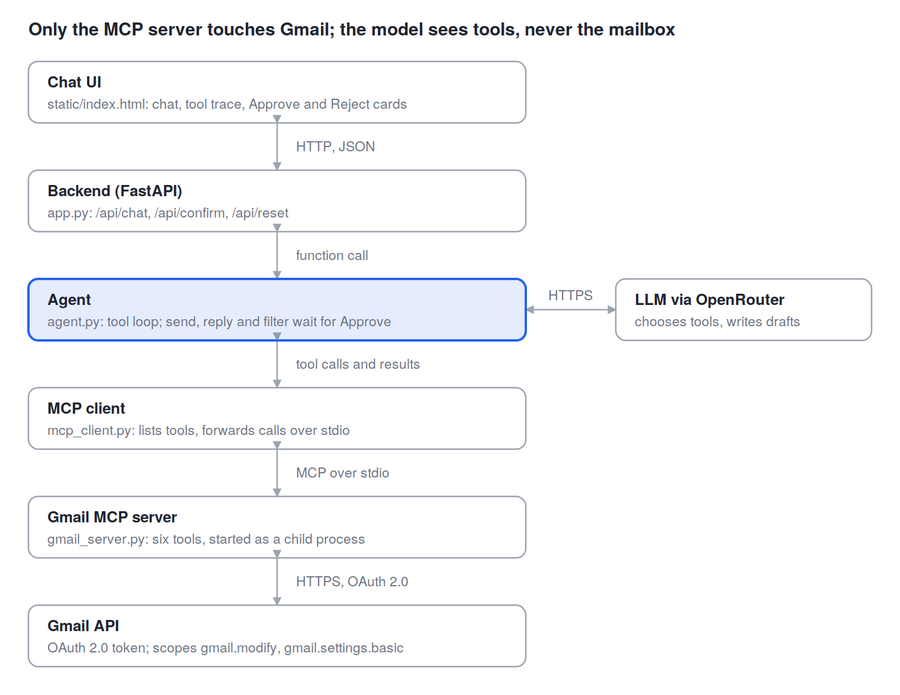
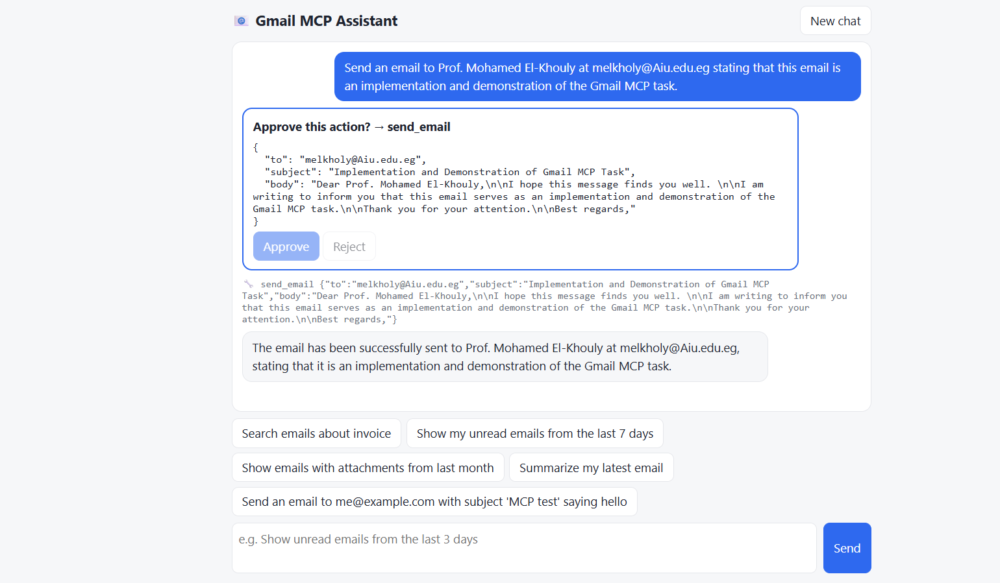

# Gmail MCP Assistant

Chat UI + LLM (OpenRouter) + MCP client -> custom Gmail MCP server -> Gmail API.

## Architecture


Requests travel down the layers and results return the same way. Only the MCP server talks to Gmail; the LLM only sees the tool list.

## Demo

**. Test email sent through MCP.** The model composes a formal email from a one-line instruction; after Approve, `send_email` runs through the MCP server.



## Setup
1. Google Cloud Console: new project -> enable **Gmail API** -> OAuth consent screen (External, add your own Gmail as *Test user*) -> Credentials -> **OAuth client ID, type Desktop app** -> download JSON as `credentials.json` into this folder.
2. `pip install -r requirements.txt`
3. Copy `.env.example` to `.env`, put your OpenRouter key (https://openrouter.ai/keys) and your email in `TEST_EMAIL`.
4. `python auth_setup.py` -> browser opens, approve access -> `token.json` is created.
5. `python app.py` -> open http://127.0.0.1:8000
6. Test: in the chat type `Send an email to <your address> with subject 'MCP test' saying hello`, press **Approve**, check your inbox.
7. `python evaluate.py` runs the automatic evaluation and writes `evaluation_results.md` / `.json`.

## MCP tools
| Tool | Purpose | Needs approval |
|---|---|---|
| search_emails | Gmail query syntax search | no |
| filter_emails | structured filters (sender, unread, attachment, dates, label) | no |
| read_email | full body of one message | no |
| send_email | send new mail | **yes** |
| reply_to_email | threaded reply | **yes** |
| create_auto_filter | persistent Gmail filter + label | **yes** |

## Design decisions
- Own MCP server instead of a third-party one: full control of the tools, minimal OAuth scopes, nothing hosted by others.
- stdio transport: server runs as a child process of the client, no network port exposed.
- MCP tool schemas are converted automatically to LLM function schemas, so adding a tool needs no client change.
- Human-in-the-loop enforced in code (not only in the prompt): the agent loop pauses before any state-changing tool.
- UI renders email text with `textContent`, so a malicious email cannot inject HTML/JS.
- Prompt-injection note: email bodies are untrusted; approval gate means an injected "send this to X" still needs a human click.

## Evaluation
`evaluate.py` runs scripted prompts and checks the tool chosen, its arguments, and safety:
tool-selection accuracy (search / filter / read), argument correctness (unread_only, has_attachment, recipient),
action success (send + reply approved), and safety (rejected send is never executed). It also records latency
per case and writes `evaluation_results.json`.
Limits: depends on the chosen LLM; small mailbox/test data; no multi-account support.

## Security notes
- `.env`, `credentials.json` and `token.json` are secrets: never commit or share them (see `.gitignore`).
- State-changing tools (send, reply, create filter) require explicit approval in the UI.
- OAuth scopes are limited to `gmail.modify` and `gmail.settings.basic` (no permanent delete).

## Project layout
```
app.py            FastAPI backend (serves UI, /api/chat, /api/confirm, /api/reset)
agent.py          LLM tool-calling loop + human-in-the-loop gate
mcp_client.py     MCP client (stdio) -> tool schema conversion
gmail_server.py   Gmail MCP server (6 tools)
gmail_auth.py     OAuth helper;  auth_setup.py  one-time login
evaluate.py       automated evaluation (7 cases)
static/index.html chat UI
```
